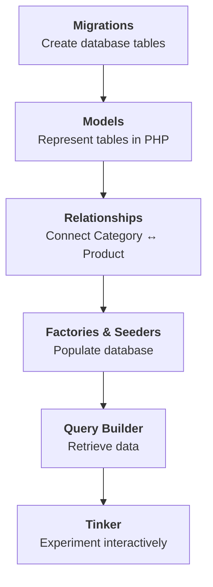
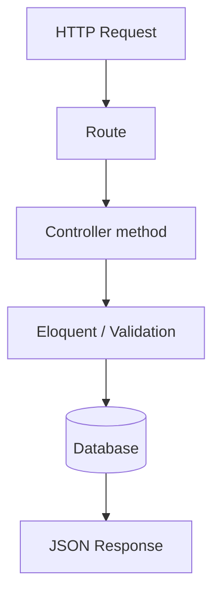
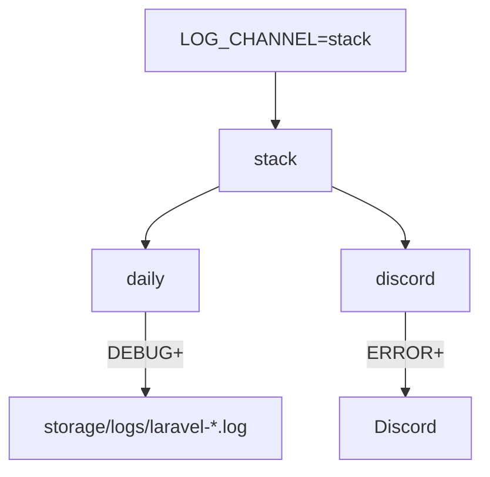
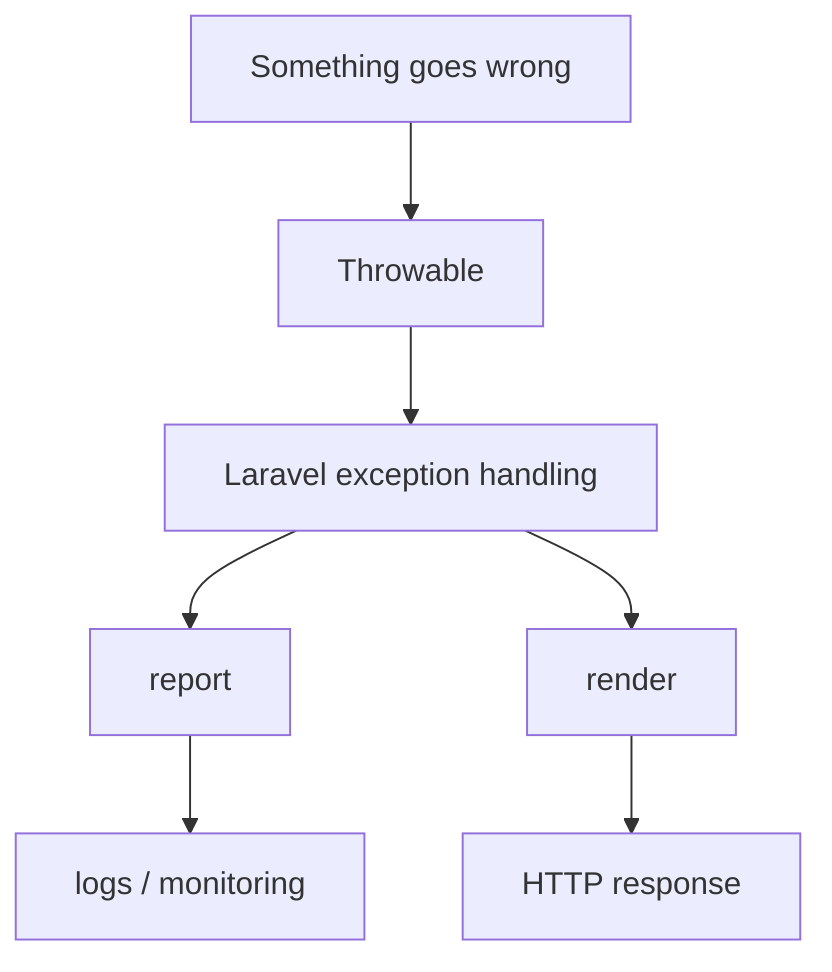
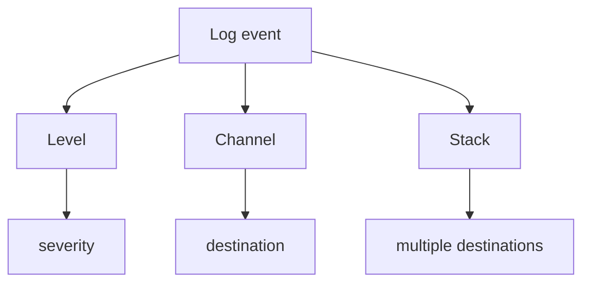
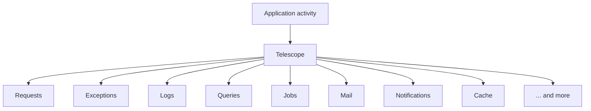

# **Laravel Framework Lab - Coffee Shop**

## **NOTES**
### **Run Application**
```shell
php artisan serve
```

### **Automatically Fix Formattings with PINT**
```shell
.\vendor\bin\pint --test
.\vendor\bin\pint
```

### **For *Herd* Users**
```bash
netstat -ano | findstr :80
net stop http
netstat -ano | findstr :80
```

## **Sections**
### **Section 1 - Working with Database**
**Ideas:**
|Concept | Description |
| :--- | :--- |
| Relationship | connection betwen models/table |
| `hasMany()` | one category has many products |
| `belongsTo()` | one product belongs to one category | 
| Factory | recipe for generating model data |
| Seeder | inserts predefined/sample data |
| Query Builder | builds database queries using PHP |
| Tinker | interactive Laravel/PHP REPL |


**Section 1 flow:**


## **Section 2 - Build a REST API**
**Workflow**


## **Section 3 - Error Handling & Logging**



The logging architecture


Telescope:


## **Session 5 - Testing**
```bash
php artisan test
 ADMIN@KIAN D:\....\coffee-shop  main php artisan test

   PASS  Tests\Unit\ExampleTest
  ✓ that true is true                                                                                                                0.01s  

   PASS  Tests\Unit\Models\CartItemModelTest
  ✓ able to get cart                                                                                                                 0.49s  
  ✓ able to get product                                                                                                              0.02s  

   PASS  Tests\Unit\Models\CartModelTest
  ✓ able to get cart items                                                                                                           0.03s  
  ✓ able to get cart order                                                                                                           0.04s  
  ✓ able to get cart total amount attribute                                                                                          0.03s  
  ✓ able to get cart formatted total amount attribute                                                                                0.02s  

   PASS  Tests\Unit\Models\CategoryModelTest
  ✓ able to get products                                                                                                             0.04s  

   PASS  Tests\Unit\Models\OrderModelTest
  ✓ able to get cart                                                                                                                 0.02s  
  ✓ able to get signed path to order detail page                                                                                     0.09s  

   PASS  Tests\Unit\Models\ProductModelTest
  ✓ able to get category                                                                                                             0.04s  
  ✓ able to get formatted price attribute                                                                                            0.02s  
  ✓ able to get formatted total amount                                                                                               0.02s  

   PASS  Tests\Unit\Notifications\OrderCreatedNotificationTest
  ✓ should send order created notification                                                                                           0.09s  

   PASS  Tests\Unit\Services\CartServiceTest
  ✓ get valid cart instance                                                                                                          0.04s  
  ✓ get cart with correct user id                                                                                                    0.03s  
  ✓ should return new cart current cart already have order                                                                           0.02s  
  ✓ get cart should return same instance on multiple called times                                                                    0.03s  
  ✓ get cart item by product id                                                                                                      0.03s  
  ✓ remove cart item by product id                                                                                                   0.03s  
  ✓ add cart item                                                                                                                    0.02s  

   PASS  Tests\Unit\Services\UserServiceTest
  ✓ should return user iud from session                                                                                              0.03s  
  ✓ should return same user id in case generate session id                                                                           0.02s  
  ✓ should return new user id in case flush session                                                                                  0.03s  

   PASS  Tests\Feature\Controllers\CheckoutControllerTest
  ✓ can render checkout page                                                                                                         0.04s  
  ✓ display correct cart data                                                                                                        0.04s  
  ✓ got validation errors                                                                                                            0.03s  
  ✓ can create order when submit checkout                                                                                            0.11s  

   PASS  Tests\Feature\ExampleTest
  ✓ returns a successful response                                                                                                    1.95s  

  Tests:    29 passed (55 assertions)
  Duration: 3.71s
```